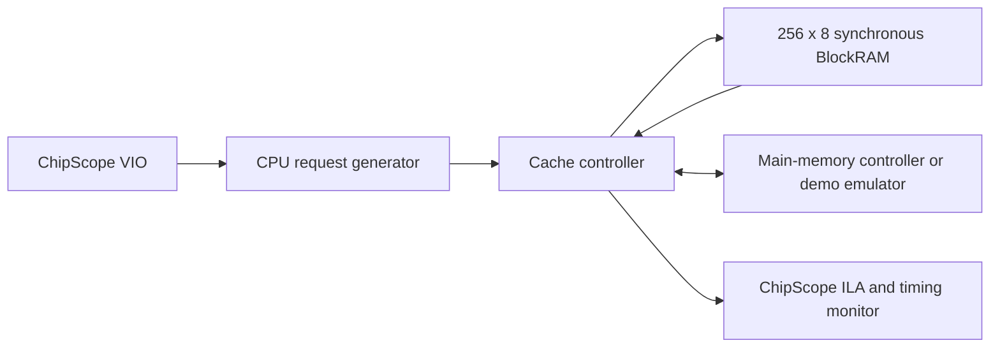

# FPGA Cache Controller

A VHDL project for a 256-byte direct-mapped cache with write-back and write-allocate behavior, designed for a Xilinx Spartan-3E FPGA.

**Status: requirements and implementation planning.** The corrected RTL, automated regression, FPGA build, and hardware measurements have not been completed. This repository records the work as it happens; it does not present the supplied legacy ZIP as original work or a passing implementation.

The cache accepts 16-bit byte addresses and 8-bit data. Eight cache lines each hold 32 bytes. Valid, dirty, and tag metadata determine whether to service a request locally, refill a line, or write a dirty victim back before refilling.

## Project documents

- [Requirements and acceptance criteria](docs/requirements.md)
- [Legacy ZIP reuse and attribution](docs/reuse.md)
- [Hardware demonstration and evidence checklist](docs/demo.md)
- [Source inventory](docs/source-manifest.json)

## Planned verification

The implementation will use portable, synthesizable VHDL-93 for the controller, a self-checking simulation environment with full 16-bit main-memory addressing, and a separate Spartan-3E integration using the course CPU generator and ChipScope. Simulation checks will include all four behavioral cases, every byte offset and cache index, dirty eviction recovery, high-address independence, and CPU/memory protocol timing.

Hardware emulation will use an explicitly documented set of full-address demo memory blocks if a supplied main-memory controller is unavailable. That bounded emulator will not be described as a full SDRAM implementation.

## Hardware status

The user has confirmed the Spartan-3E FPGA family. The exact board model, FPGA part/package/speed grade, oscillator frequency, pin mapping, and installed ISE/ChipScope version still need to be recorded from the physical board and lab setup before hardware constraints or a bitstream can be finalized.

## Attribution

This project is based on the COE758 cache-controller requirements. The supplied ZIP contains a course CPU transaction generator whose header credits Victor Dumitriu at Ryerson University, Xilinx-generated IP, and a legacy cache implementation. Reuse decisions are recorded in `docs/reuse.md`. Third-party source, course PDFs, and generated vendor IP remain local rather than being committed to this public repository. The corrected cache controller, tests, build recipes, and project documentation will be developed in this repository with their own commit history.
