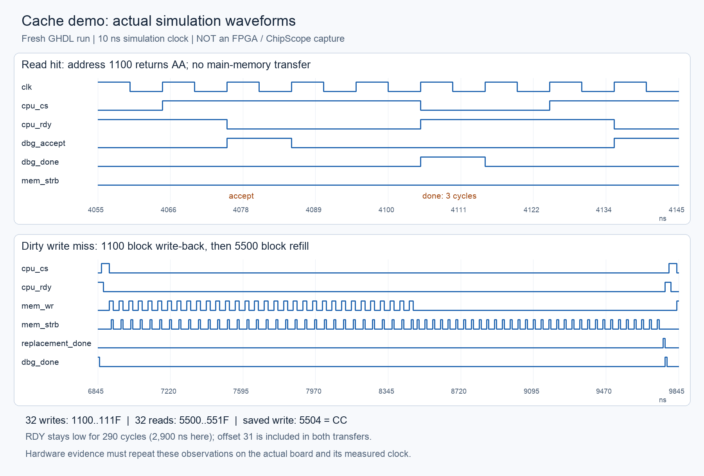

# Running and demonstrating the cache project to the TA

For Spartan-3E and Xilinx ISE 13. Start with the [README](../README.md) for the short version. The board wrapper is included; generate the ChipScope cores and fill in the actual clock constraints before building hardware.

## 1. Establish the actual board configuration

Read the FPGA marking and board manual. Record board model, complete FPGA part/package/speed, oscillator frequency, oscillator pin, reset polarity, I/O voltage/standard, and programming cable. “Spartan-3E” identifies a family, not enough information to assign pins or build a bitstream. Record the ISE 13 minor version and available ChipScope license/tools. Use the lab workstation's supported installation.

Use ISE Project Navigator/XST, ISim, iMPACT and ChipScope Pro for this platform. The build script targets this workflow, but its vendor commands still need to be run on the lab workstation. Spartan-3E is an ISE-supported family: [AMD ISE architecture table](https://docs.amd.com/v/u/en-US/irn). The modern Vivado device list does not include Spartan-3E: [AMD supported devices](https://docs.amd.com/r/2025.1-English/ug973-vivado-release-notes-install-license/Supported-Devices).

## 2. Run the existing simulations first

Open a terminal in the project folder and run:

```sh
make test
make demo
```

The runner automatically finds the downloaded GHDL in this checkout. On another computer, install GHDL or set `GHDL` to its executable. These commands are terminal simulation commands, not commands for the ISE Tcl console.

Expect `PASS run_tests.sh`, the Python build-script tests reporting `OK`, and `PASS run_tests.sh demo`. The core should report 1,310 transactions for each memory timing mode. The local supplied-CPU test should report all eight vectors passing; on a clean public clone that optional source is absent and the test explicitly skips. This is not equivalent to testing the supplied CPU there.

Open these new waveforms in GTKWave if available:

- `build/ghdl/demo/tb_demo_course.ghw`: default eight course vectors.
- `build/ghdl/demo/tb_demo.ghw`: extended sixteen-vector run.

Select the signals listed in section 5, put address/data buses in hexadecimal, counters in unsigned decimal, and zoom to the active interval. Both demo modes use a 10 ns simulated clock and report PASS at about 83 us. The useful course transactions finish at about 13 us and extended transactions at about 23 us; the later idle interval tests that holding trigger high does not start another sequence.

## 3. Reproduce behavioral simulation in ISE 13 / ISim

1. In Project Navigator choose **File > New Project**, choose a new project location, and select an HDL project. Set VHDL, XST and ISim, and the exact Spartan-3E part from the board. Do not open the old ZIP's project as the current design.
2. Add these design sources in dependency order: `rtl/cache_pkg.vhd`, `rtl/cache_ram.vhd`, `rtl/cache_controller.vhd`, `rtl/cache_system.vhd`, `rtl/demo_memory.vhd`, `rtl/demo_cpu.vhd`, `rtl/demo_monitor.vhd`, `rtl/demo_top.vhd`.
3. Add `sim/tb_demo.vhd` as a simulation source. Switch to **Simulation / Behavioral**, select `tb_demo`, and run **Simulate Behavioral Model**. The testbench generic defaults to `EXTENDED_DEMO=true`, even though the design entity defaults to false.
4. Run for 100 us. Require `PASS tb_demo`, `demo_fault=0`, `demo_pass=1`, and the extended totals below. If the simulator stops at its short default duration, continue to 100 us; initialization alone takes over 2.5 us at this simulated clock.
5. Restart/re-elaborate with the testbench generic `EXTENDED_DEMO=false` using the simulator/project generic settings, then run 100 us again. Require the eight-vector totals. If the GUI exposes no convenient generic override, use a separate local testbench copy with that generic default set to false.
6. For the full regression, add `sim/cache_tb_pkg.vhd`, `sim/main_memory_model.vhd`, `sim/tb_cache_ram.vhd`, and `sim/tb_cache.vhd` as simulation sources. Select `tb_cache` as simulation top and run 3 ms. Repeat with `REGISTERED_MEMORY=true`. Run `tb_cache_ram` for 100 ns separately. Avoid running those benches beyond their deliberate watchdog failure times after PASS.
7. If demonstrating the original supplied CPU, also add local `reference/local/course_cpu.vhd` and `sim/tb_course_cpu.vhd` to simulation, select `tb_course_cpu`, and run 20 us. The course CPU uses Synopsys arithmetic packages; the cache RTL uses `numeric_std`. Keep the original CPU separate from `demo_cpu`.

Do not include testbenches in FPGA synthesis. They contain delays, unbounded test processes and simulation-only arrays. A successful behavioral run is evidence for behavior, not evidence of a programmed FPGA. Local verification uses GHDL. If ISim fails, investigate its first compiler message.

## 4. Build the FPGA top

1. Generate the three cores using [the ChipScope setup table](chipscope.md): `cache_icon` with two control ports; `cache_ila` with one 128-bit trigger/data port and depth 512; `cache_vio` with 192 synchronous input bits and two synchronous output bits. Disable optional ports not listed there. Keep the three `.ngc` files together in `ip/generated/chipscope/`.
2. Copy `constraints/board.ucf.example` to `board.ucf`. Fill in the actual oscillator pin, I/O standard and clock period. The supplied `cache_board_top` has just one physical port, `clk`. Reset and trigger come from VIO; the internal observation buses are already wired.
3. From the repository root, run in the ISE Tcl shell:

   ```sh
   xtclsh scripts/build_ise.tcl xc3s500e-4-fg320 board.ucf ip/generated/chipscope course
   ```

   Replace the example part with the board's exact device-speed-package. Use `extended` for the recovery-check build. The script selects `cache_board_top`, adds the nine RTL sources and three generated cores, checks process completion and requires a new bitstream.
4. For a manual GUI build, add the eight RTL files from section 3 plus `rtl/cache_board_top.vhd`, the three generated `.ngc` files and the UCF. Set `cache_board_top` as top. Its `EXTENDED_DEMO` generic is false for course mode and true for extended mode. Keep every `sim/` file out of synthesis.
5. Decide which backend is acceptable for the course: the current eight-block emulator or the lab's specified main-memory controller. The emulator represents only 256 backing bytes. If replacing it, verify read data is valid at the end of MEMSTRB; this controller has no memory-ready handshake.
6. Review **Synthesize - XST**, **Implement Design**, **Generate Post-Place & Route Static Timing** and **Generate Programming File** results. Confirm the cache RAM maps to BlockRAM/RAMB16, the full design fits, all generated cores resolve, and the clock meets timing. GHDL RAM recognition alone does not establish physical mapping.
7. Use iMPACT to initialize the JTAG chain, assign `build/ise_demo/cache_board_top.bit` to the correct FPGA, and program it. Open ChipScope Pro Analyzer, connect to the cable, and label the buses with [the probe map](chipscope.md). Save the Analyzer setup with the captures for this build.

With 512 ILA samples, capture individual cases across separate reset/runs. A full eight-vector run needs about 1,010 post-trigger samples, so increase depth to 2,048 only if it fits. The extended run needs about 1,980 samples; a 4,096-depth, 128-bit capture can exceed the board's BlockRAM capacity. Targeted captures avoid that problem. Counters are available through VIO without storing them every clock.

## 5. Configure the useful views

| View | Signals to show | Display |
|---|---|---|
| CPU transaction | `cpu_cs`, `cpu_wr`, `cpu_addr`, `cpu_wdata`, `cpu_rdy`, `cpu_rdata`, `dbg_accept`, `dbg_lookup`, `dbg_done`, `dbg_case` | Address/data hex; case unsigned or labeled |
| Memory transfer | `mem_addr`, `mem_wr`, `mem_strb`, `mem_wdata`, `dbg_byte`, `dbg_replacement_done` | Address/data hex, byte offset decimal |
| Cache metadata | `dbg_valid`, `dbg_dirty`, `dbg_state` | Masks hex/binary; state unsigned |
| Final result / measurements | `init_done`, `cpu_finished`, `demo_pass`, `demo_fault`, counts, timing counters, `saw_offset_31` | Flags binary; counts decimal |

The supplied ILA bus contains the fields listed in the [probe map](chipscope.md). It does not include `mem_rdata` or local cache RAM ports. Adding those signals requires changing the probe map and regenerating a matching ILA core. No VGA, UART, seven-segment display or LED animation is implemented by the current source; the meaningful visuals are waveforms, values, diagrams and implementation reports. LEDs require explicit wrapper wiring.

## 6. Run a fresh hardware demonstration

1. In VIO set `trig=0`, then hold `rst=1` for several cache clocks. Human-time VIO operations are long enough. The internal reset takes two synchronizing stages to propagate.
2. Set `rst=0`. **Now wait for `init_done=1`**. Initialization writes 256 bytes after reset release; it never finishes while reset is held. Verify `cpu_rdy=1`, valid/dirty masks `00`, counts zero, fault zero and no memory strobe before starting.
3. Arm ILA before triggering. For a whole run, trigger on the first `dbg_accept`. For a dirty-miss view, use `dbg_lookup=1` and `dbg_case=5` for dirty write or `dbg_case=4` for dirty read; optionally qualify by CPU address. Put most capture samples after the trigger.
4. Set VIO `trig` from 0 to 1. **One edge launches the entire sequence.** Bring it low when convenient. Holding it high must not cause another run.
5. Wait for `cpu_finished=1`. Verify pass=1, fault=0 and exact totals. Read the ILA capture. To capture another case, reset, release reset, wait for initialization, arm ILA and trigger again. The current top does not restart a finished sequence just from another trigger.
6. Demonstrate the default eight-vector run, then an extended build selected by the script's `extended` argument (`EXTENDED_DEMO=true` on `cache_board_top`). That is an elaboration/build setting, not a runtime VIO bit. Reprogram the matching bitstream/probe mapping and reset before the extended run.

## 7. Expected course sequence

Step numbers match the zero-based tables in the source. R/W counts below are **main-memory byte strobes during that transaction**, not cache RAM operations.

| Step | CPU request | Case / expected result | Memory R/W | Acceptance-to-done clocks |
|---:|---|---|---:|---:|
| 0 | Write `1100=AA` | Clean write miss, refill index 0, mark dirty | 32 / 0 | 130 |
| 1 | Write `1102=BB` | Write hit | 0 / 0 | 2 |
| 2 | Read `1100` | Read hit, **AA** | 0 / 0 | 3 |
| 3 | Read `1102` | Read hit, **BB** | 0 / 0 | 3 |
| 4 | Read `3346` | Clean read miss, **FF**, index 2 | 32 / 0 | 131 |
| 5 | Read `4444` | Clean replacement of index 2, **FF** | 32 / 0 | 131 |
| 6 | Write `5504=CC` | Dirty write miss, old block `1100` written back | 32 / 32 | 290 |
| 7 | Read `6606` | Dirty read miss, old block `5500` written back; **FF** | 32 / 32 | 291 |

Case encodings: 0=read hit, 1=write hit, 2=clean read miss, 3=clean write miss, 4=dirty read miss, 5=dirty write miss. These are debug encodings, not the assignment's four case numbers. A write's `cpu_rdata` is not a write acknowledgement value; use RDY/completion and later readback.

For step 6, show 32 write strobes at `1100..111F`, with `AA` at `1100` and `BB` at `1102`, followed by 32 read strobes at `5500..551F`. Then the saved write places `CC` at CPU address `5504` (local cache RAM address `04`) and RDY returns high. For step 7, show the write-back `5500..551F` including `CC` at `5504`, then refill `6600..661F`. Byte 31 must appear in both phases.

During hits, MEMSTRB remains zero. During a miss, RDY remains low until replacement and the original byte operation finish. Every memory strobe is one clock and has a preceding setup cycle; the implementation intentionally inserts additional cycles between bytes. Interpret `mem_wr` only with MEMSTRB asserted: direction need not remain high through every idle/write-back preparation state.

## 8. Extended recovery checks and final values

| Step | CPU request | Expected observation | Memory R/W | Clocks |
|---:|---|---|---:|---:|
| 8 | Read `1100` | **AA** recovered after eviction | 32 / 0 | 131 |
| 9 | Read `1102` | **BB** recovered, hit | 0 / 0 | 3 |
| 10 | Read `5504` | **CC** recovered after dirty eviction | 32 / 0 | 131 |
| 11 | Read `9100` | **FF**, distinct from `1100` | 32 / 0 | 131 |
| 12 | Write `911F=D7` | Write hit at offset 31 | 0 / 0 | 2 |
| 13 | Read `1100` | **AA**; dirty `9100..911F` written back | 32 / 32 | 291 |
| 14 | Read `911F` | **D7** recovered from main memory | 32 / 0 | 131 |
| 15 | Read `22FF` | **FF**, index 7 / offset 31 | 32 / 0 | 131 |

| Final observation | Eight vectors | Sixteen vectors |
|---|---:|---:|
| `completed_count` | 8 (`08` hex) | 16 (`10` hex) |
| `memory_read_count` | 160 (`00A0`) | 352 (`0160`) |
| `memory_write_count` | 64 (`0040`) | 96 (`0060`) |
| `demo_pass` / `demo_fault` | 1 / 0 | 1 / 0 |
| `init_done`, `cpu_finished`, `cpu_rdy`, `saw_offset_31` | All 1 | All 1 |
| `dbg_valid` / `dbg_dirty` | `05` / `00` | `85` / `00` |
| `last_latency` / `max_latency` | 291 / 291 | 131 / 291 |
| Final `replacement_cycles` | 288 | 128 |

The replacement counter holds the **last replacement's** duration. It is not a cumulative count or a stored pair of clean/dirty measurements. Capture both types separately. Final pass may update a clock after the last completion while monitor events settle; wait for the stable finished result.

## 9. Six required measurements and screenshots

| Assignment result | Expected cycles for this RTL | What to demonstrate |
|---|---:|---|
| Hit/miss determination | 1 | Acceptance to registered lookup classification |
| Data access | 1 for RAM setup-to-capture observation | Show local synchronous RAM timing and state your event definition; this is not an analog propagation-delay measurement |
| Block replacement | Clean 128; dirty 288 | Lookup event to replacement-complete event |
| Hit time, cases 1 and 2 | Write 2; read 3 | Acceptance to write commit / read response and RDY return |
| Clean miss penalty | 128 additional | Total clean write/read miss 130/131, less corresponding 2/3-clock hit |
| Dirty miss penalty | 288 additional | Total dirty write/read miss 290/291, less corresponding hit |

Use `time_ns = cycles * 1000 / clock_MHz` with the **actual cache clock**. For illustration only, 50 MHz means 20 ns per clock: lookup/RAM 20 ns; clean/dirty replacement 2,560/5,760 ns; write/read hits 40/60 ns. This audit does not establish that the board runs at 50 MHz. The simulation uses 100 MHz (10 ns), so its displayed nanoseconds must not be copied into the hardware results without checking the board clock. Report both total miss latency and additional penalty to avoid ambiguity in the assignment's terminology.

Show the TA, in order:

1. An original controller symbol/system block diagram: CPU -> controller plus 256 x 8 BlockRAM -> backing-memory interface; shared clock, tag/index/offset split, valid/dirty metadata and debug connections. Show the FSM diagram if required for your report.
2. Fresh XST/MAP utilization and timing reports for the actual FPGA, including cache BlockRAM and debug resource fit.
3. A read/write hit capture: AA/BB returned correctly, dirty bit set on writes, no memory strobes, RDY/completion timing.
4. A clean miss capture: exactly 32 requested-block reads, including offset 31, then correct response.
5. A dirty miss capture: old-tag write-back addresses/data first, new-tag refill second, 32 strobes in each phase, then original operation completion.
6. An extended recovery capture returning AA, BB, CC and D7 after eviction; show high-address and last-byte checks.
7. A stable final pass/counts view and the six measurements in cycles and ns. Save/export captures, probe setup and report pages for the final report.



The image records the audit baseline simulation before the trigger synchronization fix. Transaction behavior and cycle latencies are unchanged; absolute start times shift slightly. It is not an FPGA capture. The complete extracted values are in [transaction-ledger.json](audit-evidence/transaction-ledger.json).

## 10. If ISE still fails

| Symptom | First check |
|---|---|
| Cannot find/open an ISE project | The repository does not ship a current `.xise`; create the new project and source set above |
| Cannot find `cache_pkg` or an entity | Add the package/dependencies, use the correct work library, select the correct top |
| Synthesis complains about waits, huge test arrays or delays | A simulation file/testbench was included in implementation |
| MAP/placement reports too many I/Os | Select the supplied `cache_board_top`, which keeps debug signals internal |
| Missing ICON/ILA/VIO or black boxes | Generate the exact core names/ports in `chipscope.md` and add their matching netlists |
| UCF names do not exist or pins conflict | Constraints must name the actual wrapper ports and exact board/package |
| Script exits successfully but no fresh bitstream | Check each process result/report; Check the final process status, output directory and error text; the script rejects absent new output |
| `init_done` never rises | Release active-high reset and confirm the common clock is running |
| Trigger does nothing | Initialization incomplete, trigger already high before arming, or sequence already finished; reset and follow section 6 |
| Simulation shows no pass after 1 us | Increase run duration; memory initialization and the sequence need longer |
| Wrong bytes with a replacement memory controller | Check data availability at end of MEMSTRB and any added latency/handshake |

When asking for help with an ISE failure, copy the first error, its source file/line and the failed process. The final summary usually does not explain the cause.
